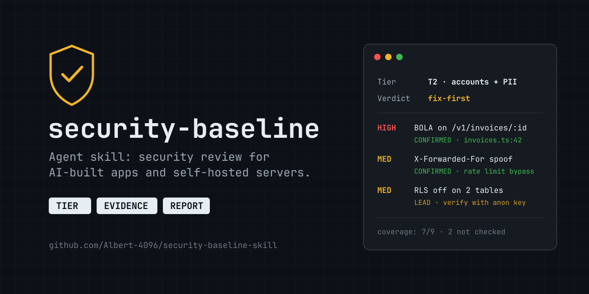

<p align="center">
  
</p>

<p align="center">
  <a href="LICENSE"></a>
  
  
  
</p>

**AI writes code that does what you asked. Security is almost never part of what you asked.**
"Show users their invoices" contains no instruction to stop user A from reading user B's invoice by changing an ID, so that check doesn't get written.

`security-baseline` is an agent skill that makes Claude Code (or any agent that reads `SKILL.md` skills) review a project or a server the way a security engineer would: decide how much security it actually needs, collect evidence, hunt the specific bugs AI-generated code ships by default, and write a report you can act on.

---

## Install

**Claude Code (plugin):**

```text
/plugin install security-baseline --marketplace Albert-4096/security-baseline-skill
```

On older Claude Code versions:

```text
/plugin marketplace add Albert-4096/security-baseline-skill
/plugin install security-baseline@security-baseline
```

**As a plain skill** (Claude Code, Codex, other agents that read `~/.claude/skills` or `~/.agents/skills`):

```bash
git clone https://github.com/Albert-4096/security-baseline-skill
cp -r security-baseline-skill/skills/security-baseline ~/.claude/skills/
```

Then just ask:

> *"Audit my server."* · *"Review this repo for security."* · *"How secure does this project need to be?"* · *"Plan auth for this app before we build it."* · *"We leaked an API key, what now?"*

---

## What it does

| Step | What the agent does |
|---|---|
| **1. Tier** | Classifies the target from observable facts, not from what it's called: **T0** toy · **T1** public, no accounts · **T2** logins or personal data · **T3** money, PII at scale, credential stores. A server is rated at the highest tier of anything it runs. |
| **2. Evidence** | Runs two read-only scripts (host audit, code sink sweep), then does what scripts can't: traces authorization per route, checks which proxy hop sets the client IP, inventories public hostnames and what sits in front of each admin UI, compares running versions against advisories. |
| **3. Report** | A fixed shape: scope + tier → one-line verdict → findings ranked by severity, each tagged **CONFIRMED** or **LEAD** with file:line or command evidence → freshness table → **coverage** (what was *not* checked, because silence is not a pass) → next actions. |
| **4. Fix safely** | Only when asked. Stateless vs data-bearing updates, rollback digests, no database major jumps via `docker pull`, stop on registry rate limits. |

### Four modes

| You ask | Mode | Focus |
|---|---|---|
| "Start this project securely", "write AGENTS.md rules" | **Plan** | Agent constitution for `CLAUDE.md`/`AGENTS.md`, stack defaults, pre-launch gate |
| "Review this app / repo / PR" | **Code review** | Authorization, injection, secrets, headers, AI features |
| "Audit my server / VPS / homelab", "is it up to date?" | **Host audit** | Exposure, admin UIs, containers, patches, image freshness |
| "We got hacked / leaked a key" | **Incident** | Contain → preserve → assess → rotate → notify |

---

## What it hunts

The bugs AI coding assistants produce most, mapped to OWASP Top 10 (2025) and API Security Top 10 (2023):

| Class | Example |
|---|---|
| **Broken object-level authorization** (BOLA / IDOR) | `findUnique({ where: { id } })` with no owner filter |
| **Missing row-level security** | Supabase tables readable with the public anon key |
| **Client-controlled identity** | `orgId` from the request body, `X-Org-Id` header, first `X-Forwarded-For` value |
| **Mass assignment** | `{...req.body}` into an update, `{"is_admin": true}` accepted |
| **Secrets in the wrong place** | `NEXT_PUBLIC_*_SECRET`, `service_role` in the bundle, `.env` in git history |
| **Fail-open error handling** | `catch { return next() }`, swallowed authz errors |
| **Middleware-only auth** | the CVE-2025-29927 class of bypass |
| **Supply chain** | hallucinated packages (slopsquatting), no lockfile, unpinned images, `curl \| sh` |
| **Exposed infrastructure** | admin UIs on public hostnames, Docker ports bypassing the firewall, `docker.sock` mounts, stale images |
| **AI features** | the lethal trifecta: private data + untrusted content + an exfiltration channel |

---

## Example report (abridged, fictional)

```text
1. Scope and tier   repo acme-dashboard + its Supabase project. T2: logins, customer emails.
2. Verdict          fix-first.

3. Findings
   HIGH  BOLA on GET /v1/invoices/:id                       CONFIRMED
         src/api/invoices.ts:42 queries by id only. Replayed A's request with B's
         token: 200 + B's invoice. Fix: where { id, orgId: session.orgId }, 404 otherwise.
   MED   Login rate limit bypass via X-Forwarded-For         CONFIRMED
         server.ts:99 trusts the first XFF value; the proxy appends. Fix: use the last hop.
   MED   RLS disabled on `audit_log`, `invites`              LEAD
         pg_tables query lists them; anon REST probe not yet run.

4. Coverage         checked §4 authz, §7 RLS, §8 secrets, §10 headers.
                    NOT checked: file uploads, webhook signatures (no access to Stripe config).
5. Next actions     1. owner filter in the invoice query  2. XFF fix  3. enable RLS + policies
```

---

## The scripts

Both are read-only, need no sudo, and print secret **names and paths only**, never values. Every hit is a lead the agent must confirm by reading the code.

```bash
# Host: OS patches, reboot flag, listening sockets, firewall, sshd, every container's
# user / privilege / published ports / docker.sock, image freshness vs the registry.
bash skills/security-baseline/scripts/audit-docker-host.sh
ssh myhost 'bash -s -- --remote-digests' < skills/security-baseline/scripts/audit-docker-host.sh

# Code: secrets, injection, XSS, mass assignment, client-supplied tenant IDs, proxy-IP trust,
# fail-open catches, weak crypto, lockfiles, Dockerfile/compose risks, route inventory.
bash skills/security-baseline/scripts/scan-code.sh path/to/project
```

`--remote-digests` asks the registry for each image's current digest. On Docker Hub that counts against the anonymous pull quota, so run `docker login` first.

---

## Repository layout

```text
.claude-plugin/              plugin + marketplace manifests
skills/security-baseline/
  SKILL.md                   the procedure the agent follows (tier → evidence → report → fix)
  references/baseline.md     the full reference, §0–§18: OWASP mappings, API design, RLS,
                             secrets, supply chain, headers/CSP/CORS, AI features, n8n,
                             ops, compliance checklist, pre-launch gate, incident response
  scripts/                   audit-docker-host.sh, scan-code.sh
```

`references/baseline.md` also works on its own: paste §2 (the *Agent Constitution*) into your `AGENTS.md` / `CLAUDE.md` / Lovable system prompt before you start building.

---

## How it was tested

The skill was built test-first: the same review task was given to an agent with and without the skill, on a real production app and a real ~80-container self-hosted server. Both runs found the main bug. With the skill, the reports added a tier, a verdict, CONFIRMED/LEAD evidence and an explicit coverage list, and the host audit found exposed admin UIs, open sign-ups, a proxy-IP spoof and stale images. Gaps found during testing went back into the skill and the scripts.

## Safety and scope

Use it only on systems you own or are authorized to test. The skill tells the agent to stay read-only until the report is done, to never print secrets, and to change things only when you ask. It is not a substitute for a professional penetration test on T3 systems. The compliance section is an engineering checklist, not legal advice.

## Contributing

Issues and PRs are welcome, especially new grep patterns with a real-world false-positive rate, stack-specific checks (Rails, Django, Laravel, Go), and reports of where the agent misjudged a tier.

## License

[MIT](LICENSE)
